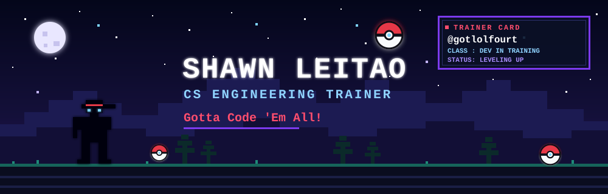

<div align="center">



<a href="https://github.com/gotlolfourt">
  
</a>

</div>


<h2 align="center">📟 POKÉDEX ENTRY #001 — SHAWN</h2>

<div align="center">

```
╔════════════════════════════════════════╗
║  POKÉDEX ENTRY #001 — SHAWN            ║
╠════════════════════════════════════════╣
║  CURRENT CLASS : Developer in Training ║
║  TYPE          : Curious / Problem     ║
║                  Solver                ║
║  SPECIAL ABILITY: Never Give Up        ║
║  CURRENT MISSION: Build projects and   ║
║                   level up my skills   ║
╚════════════════════════════════════════╝
```

</div>

> A curious Computer Science student who enjoys solving problems, exploring new technologies, and building creative projects. Currently training in **programming, data structures, AI/ML, and web development**.


<h2 align="center">⚔️ PROGRAMMING TYPE CHART</h2>

<p align="center"><i>Playful labels, not proficiency claims.</i></p>

<div align="center">

| Move / Skill | Type | Icon |
|:--|:--:|:--:|
| **C** |  |  |
| **C++** |  |  |
| **Python** |  |  |
| **Java** |  |  |
| **HTML / CSS / JavaScript** |  |  |
| **Git / GitHub** |  |  |
| **SQL** |  | 🗄️ |

</div>


<h2 align="center">📊 BATTLE STATUS — GITHUB</h2>

<div align="center">

```
┌────────────────────────────────────────┐
│ TRAINER  SHAWN          @gotlolfourt   │
│ HP  [██████████]  motivation: full     │
│ Live stats load below ▼                │
└────────────────────────────────────────┘
```


<sub>If a card is blank, the free stats service is rate-limited. <a href="https://github.com/gotlolfourt?tab=overview">View live stats on GitHub</a> instead.</sub>

</div>


<h2 align="center">🎒 MY PARTY — FEATURED PROJECTS</h2>

<div align="center">

<table>
<tr>
<td width="50%" valign="top">

**♟️ Lightweight Chess Bot** &nbsp; 

A terminal chess engine in pure C. The AI uses **Minimax with alpha-beta pruning**, with a linked list for legal moves, a stack for undo, a queue for candidate moves, and an N-ary game tree for search.

 &nbsp;`Minimax` `Alpha-Beta` `Data Structures`

🔗 [**gotlolfourt/Lightweight-Chess-Bot**](https://github.com/gotlolfourt/Lightweight-Chess-Bot)

</td>
<td width="50%" valign="top">

**🏦 NexaBank** &nbsp; 

Intelligent Onboarding System.

<!-- TODO: add a 1-line description of what it actually does -->
`TODO: add tech stack`

🔗 `TODO: add repo link`
<!-- TODO: replace the line above with: [**gotlolfourt/YOUR-NEXABANK-REPO**](https://github.com/gotlolfourt/YOUR-NEXABANK-REPO) -->

</td>
</tr>
<tr>
<td width="50%" valign="top">

**🌊 OceanGuard** &nbsp; 

AI-powered marine monitoring.

<!-- TODO: add a 1-line description of what it actually does -->
`TODO: add tech stack`

🔗 `TODO: add repo link`
<!-- TODO: replace the line above with: [**gotlolfourt/YOUR-OCEANGUARD-REPO**](https://github.com/gotlolfourt/YOUR-OCEANGUARD-REPO) -->

</td>
<td width="50%" valign="top">

**🗄️ DBMS Mini Project (DB Lab)** &nbsp; 

Merged pull request adding **DQL queries, aggregates (GROUP BY, HAVING) and views** to a shared DBMS lab project.

`SQL` `DBMS`

🔗 [**Pull request #1**](https://github.com/Sanchit-Patil08/dbms_mini_project/pull/1) · [**Repo**](https://github.com/Sanchit-Patil08/dbms_mini_project)

</td>
</tr>
<tr>
<td width="50%" valign="top">

**❔ EMPTY SLOT** &nbsp; 

Next project loading… *(AI/ML idea in training)*

</td>
<td width="50%" valign="top">

**❔ EMPTY SLOT** &nbsp; 

Hackathon build goes here.

</td>
</tr>
</table>

</div>

<p align="center"><a href="https://github.com/gotlolfourt?tab=repositories"><b>▶ OPEN FULL PC BOX (all repositories)</b></a></p>


<h2 align="center">🏅 TRAINER ACHIEVEMENTS</h2>

<p align="center"><i>Unlocked = verifiable on my profile. Locked = goals I'm working toward.</i></p>

<div align="center">

| Badge | Status | How to unlock |
|:--|:--:|:--|
|  | ✅ Unlocked | Push a first commit |
|  | ✅ Unlocked | Ship a public project ([Chess Bot](https://github.com/gotlolfourt/Lightweight-Chess-Bot)) |
|  | 🔒 Goal | Find and fix a tricky bug, or close an issue |
|  | 🔒 Goal | Solve a milestone set of DSA problems |
|  | 🔒 Goal | Compete in a hackathon |

</div>


<h2 align="center">🗺️ ADVENTURE MAP</h2>

<div align="center">

```
  ★ STARTER ─────────── ✔ cleared
  │   "Hello, World!"
  ▼
  ⚔ TRAINING ────────── ▶ YOU ARE HERE
  │   C · C++ · Python · DSA · SQL
  ▼
  ◉ PROJECTS ────────── ▶ in progress
  │   Chess Bot · NexaBank · OceanGuard
  ▼
  ⚑ HACKATHONS ──────── 🔒 next route
  │   Team up · build fast · demo
  ▼
  ♛ SOFTWARE ENGINEER ─ 🔒 final route
```

</div>


<h2 align="center">🪪 TRAINER ID CARD</h2>

<div align="center">

```
╔════════════════════════════════════════╗
║  TRAINER CARD                          ║
║  NAME  : Shawn Leitao                  ║
║  CLASS : CS Engineering Student        ║
║  GITHUB: @gotlolfourt                  ║
╚════════════════════════════════════════╝
```

<a href="https://github.com/gotlolfourt"></a>

<!-- TODO (optional): add LinkedIn / email / portfolio badges here once you want them shown -->

</div>


<details>
<summary><b>🔒 ??? (press to reveal)</b></summary>

```
> A wild bug appeared!
> SHAWN used DEBUG.
> It's super effective!
```

</details>

<br>

<p align="center"><sub>Fan-made tribute. Pokémon is a trademark of Nintendo, Creatures Inc. and GAME FREAK inc. All artwork here is original and not affiliated with them.</sub></p>
